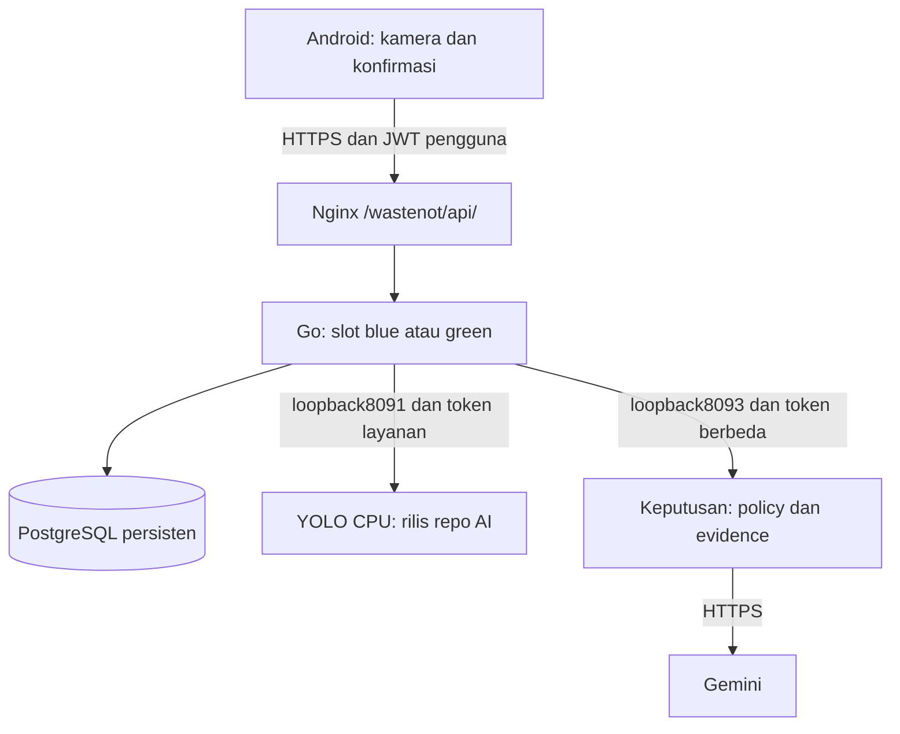

# Review pemisahan repo dan CI/CD WasteNot

Tanggal: 7 November 2026, Asia/Jakarta. Lingkup: repo AI, backend Go, pipeline CI/CD, keadaan VM dan handoff integrasi Android. Android tidak diedit; perubahan lokal pengguna dipertahankan.

## Hasil

[PR AI #1](https://github.com/waste-not-app/waste-not-ai/pull/1) dan [PR backend #1](https://github.com/waste-not-app/waste-not-backend/pull/1) telah digabung setelah pemeriksaan PR lulus. Tindak lanjut [PR backend #2](https://github.com/waste-not-app/waste-not-backend/pull/2) memindahkan probe HTTPS ke runner eksternal dan menambah pemulihan transaksi terputus. [PR AI #2](https://github.com/waste-not-app/waste-not-ai/pull/2) menyelaraskan instalasi lokal serta membekukan jam pada tes Retry-After yang bergantung waktu koleksi. Pemisahan repo dan riwayat kontribusi dipertahankan. Perbaikan tidak menambah fitur produk atau mempromosikan bobot training kandidat.

| Komponen | Rilis implementasi yang diverifikasi | Bukti |
|---|---|---|
| AI | `3a70c8997f4f4b5d6bf504de7911d8569a4780a0` | [verify + deploy sukses](https://github.com/waste-not-app/waste-not-ai/actions/runs/42272540631) |
| Go | `9d00e4a2a92344ca9d92f762c42cec7c3da10b70` | [verify sukses; deploy awal rollback aman](https://github.com/waste-not-app/waste-not-backend/actions/runs/42272839718); image kemudian diverifikasi melalui helper dua fase dan konfirmasi HTTPS dari luar VM |
| Public HTTPS | ready=true dan header source commit sesuai rilis Go | Verifikasi loopback, Nginx prefix dan HTTPS saat deploy |

Laporan ini merupakan bukti checkpoint implementasi. Commit dokumentasi sesudahnya dapat memiliki identitas rilis baru meskipun source Go/AI tetap sama; lihat `X-WasteNot-Release` dan run main terbaru untuk identitas yang melayani request saat ini.

## Temuan dan perbaikan

| Temuan yang terbukti | Perbaikan |
|---|---|
| Unit AI masih menjalankan `/opt/wastenot/current/ai-serve.py`; symlink AI bukan jalur eksekusi aktual | Unit/drop-in sekarang memakai `/opt/wastenot-ai/current/serve.py` dan `current/src`; tidak menyalin atau memutasi rilis backend |
| Deploy AI mengaktifkan source sebelum health, tanpa pemulihan | Stage immutable ber-manifest; switch atomik; health kedua worker mencocokkan commit; kegagalan memulihkan source serta drop-in sebelumnya |
| CI menulis ulang OpenAPI sebelum tes drift; 12 artifact tersimpan memang stale | Regenerasi ditinjau dan disalin ke Go; CI memakai `--check`; 34 artifact dikunci dengan pin identik dan checker lintas checkout |
| Dependency CPU yang diaudit belum diperiksa terhadap VM | Fingerprint lock dan versi paket aktual/Python diperiksa sebelum aktivasi; lock berbeda menghentikan deploy |
| Pemeriksaan model CI hanya menguji format string SHA; model_version manifest berbeda dari runtime | CI mengunduh bobot dan memeriksa hash isi; startup/deploy memverifikasi ulang; model_version diselaraskan dengan identitas checksum aktual |
| File environment gabungan VM mode0644 dalam direktori0755 | Mode dibatasi root0600; helper membaca sebagai data, memakai env-file0600 dan tidak mengeluarkan credential ke argumen/log |
| `nginx -t`/reload gagal sebelum cabang rollback sempat berjalan | Konfigurasi upstream lengkap disimpan dan dipulihkan pada kegagalan aktivasi/routing; slot tidak dihapus bila reload pemulihan gagal |
| VM tidak dapat menjangkau port443 gateway publiknya sendiri | Probe HTTPS dipindahkan ke runner eksternal; jurnal pending mempertahankan slot lama sampai konfirmasi. Kegagalan/runner terputus dapat dipulihkan tanpa melemahkan TLS |
| Switch yang terputus dapat membuat file upstream mendahului konfigurasi Nginx aktif | Rekonsiliasi route dengan slot yang sehat sebelum menyentuh container; drain slot lain sebelum penghapusan |
| Container Go kehilangan proteksi/resource cap dan memakai stop default10detik, sementara shutdown Go40detik | Nonroot/read-only/cap-drop/no-new-privileges, memori768MiB/CPU1/PID256/log terbatas, dan drain45detik |
| Dokumentasi masih menunjuk runtime dalam Android/backend dan wiring mobile lama | Handoff diperbarui terhadap PR Android #102; baseline API30+, status transport/layar, retry AI vs catatan, provenance dan batas pilot dijelaskan |

## Arsitektur yang dijalankan

Go memiliki JWT, ownership, quota, dedup/TTL durable, transaksi save dan XP/statistik. Python memiliki inference, mapping/band, policy/evidence dan Gemini. Android tidak mengakses port privat, key atau bobot. Detektor menolak egress; keputusan memerlukan HTTPS Google.

Rollback dua fase menyalakan dan memeriksa slot lama sebelum mengembalikan traffic; ini juga menangani proses yang mati setelah container lama berhenti tetapi jurnal belum dihapus. Kegagalan pemulihan mempertahankan route baru dan kedua slot untuk inspeksi.

## Verifikasi yang dilakukan

- 239 tes AI, Ruff, hash-locked runtime/CI tools dan audit CPU lock lulus.
- 34 artifact OpenAPI/error/contoh cocok terhadap pin dan kedua checkout; generator `--check` lulus tanpa menulis ulang file.
- Unduh/verifikasi bobot SHA-256 `0ebbc80d4a7680d14987a577cd21342b65ecfd94632bd9a8da63ae6417644ee1`.
- Go/PostgreSQL18: vet, race detector, tes integrasi, format, vulncheck, binary dan container build lulus.
- 27 tes helper backend: 15 kasus blue-green baru dan 12 regresi helper lama. Kasus meliputi kegagalan migrasi, Nginx, public route, pemulihan reload, interrupted switch/confirmation, pemulihan slot lama sebelum perubahan route, secret dan drain.
- Kedua workflow lulus actionlint1.7.12 serta YAML/syntax shell; CI AI PR/main lulus. CI backend PR/verify lulus; deploy main pertama sengaja tidak dinyatakan sukses karena hairpin. Hasil pipeline koreksi tersedia pada [workflow backend main](https://github.com/waste-not-app/waste-not-backend/actions/workflows/ci.yml?query=branch%3Amain).
- VM: path ExecStart aktual, current symlink, autentikasi health dengan commit, versi paket CPU, checksum model, permission config dan proteksi container diperiksa.
- Arsip AI rusak ditolak pada VM; symlink dan PID worker tetap sama. Uji rollback saat startup/Nginx gagal menggunakan simulasi; tidak mematikan layanan produksi untuk drill.
- Public smoke: **22 pemeriksaan lulus**, foto → YOLO nyata → konteks sintetis terkonfirmasi → Gemini → simpan eksplisit → replay/provenance/statistik/delete/logout. Provider `gemini`, prototype=false; satu respons rekomendasi 1723.23ms. [Hasil terstruktur](verification/2026-11-07-public-smoke.json). Kedua akun fixture dan data turunannya dibersihkan.

Latency di atas satu sampel, bukan percentile/SLA. Starlette TestClient mengeluarkan satu peringatan deprecation httpx; seluruh tes tetap lulus. Runtime tidak diganti sekadar untuk menyembunyikan peringatan.

## Acuan untuk melanjutkan Android

Baca [ANDROID.md](ANDROID.md) untuk base URL, urutan state/retry dan acceptance; [API.md](API.md) untuk HTTP core; [AI public OpenAPI](../contracts/ai/public.openapi.json) serta [contohnya](../contracts/ai/examples/) untuk DTO. Penjelasan service ada pada [integrasi AI](https://github.com/waste-not-app/waste-not-ai/blob/main/docs/INTEGRATION.md).

Yang harus dijaga pada mobile: satu UUID/payload untuk write yang hasilnya belum diketahui, refresh tunggal, kondisi/material dikonfirmasi pengguna, HTTP200 AI tidak selalu READY, CONDITIONAL tidak menjadi fakta, scan tidak otomatis menyimpan/menghasilkan XP, serta provenance hanya setelah save yang dikonfirmasi. Penerimaan perangkat API30 dan runtime terbaru tetap harus dijalankan.

## Batas yang masih terbuka

- Worker AI masih restart-based dan mempunyai jeda singkat; bukan blue-green AI. Dependency CPU/model upgrade memerlukan persiapan operator sebelum CD source; rollback source tidak otomatis mengembalikan upgrade environment di luar helper.
- CI tiap repo memeriksa pin lokal. Perubahan kontrak memerlukan pembaruan pasangan dan peer comparison; tidak ada token baca privat lintas repo yang diasumsikan.
- Model aktif tetap YOLO11n COCO. Bobot fine-tuning, independent camera/object holdout, akurasi material dan benchmark beban belum dipromosikan/dibuktikan.
- Empat policy guide versi6 menggunakan review sumber otomatis, bukan persetujuan manusia; 74 draf lain tidak diterbitkan. Artikel umum Go masih nol dan terpisah dari policy AI.
- Achievement, foto permanen, fasilitas daur ulang, reset password/penghapusan akun, restore backup menyeluruh, budget global dan penerimaan Android lengkap tetap pekerjaan tersendiri. Temuan CI yang diperbaiki tidak menutup gate tersebut.
- Script provisioning native/K3s lama adalah jejak historis; jalur deploy aktif adalah helper blue-green Go dan helper immutable AI. Tidak menghapus data/volume DB atau mengubah workload lain.

Prosedur operator: [deployment Go](DEPLOYMENT.md), [deployment AI](https://github.com/waste-not-app/waste-not-ai/blob/main/docs/DEPLOYMENT.md), dan [script smoke publik](../scripts/smoke_public.py).
