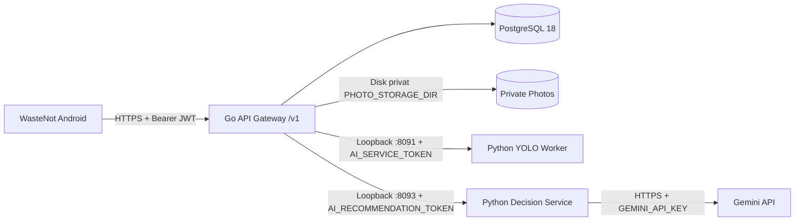

# Panduan Integrasi End-to-End: Android, Backend Go, dan AI Python

Dokumen ini menjadi acuan bersama untuk menyambungkan **WasteNot Android**, **WasteNot Backend (Go)**, dan **WasteNot AI (Python YOLO + Gemini/Rules)** secara aman dan konsisten.

## 1. Arsitektur & Batas Tanggung Jawab



- **Android** hanya berkomunikasi dengan **Go API Gateway** (`/v1/*`). Android tidak pernah memanggil port worker `8091`/`8093`, tidak menyimpan `GEMINI_API_KEY` atau `AI_*_TOKEN`, dan tidak menjalankan bobot YOLO lokal.
- **Go API Gateway** memegang autentikasi JWT + refresh session, isolasi kepemilikan (`user_id`), rate limit, idempotensi (`client_request_id`), transaksi catatan (`waste_logs`), perhitungan XP/streak/achievement, penyimpanan lampiran foto privat, dan audit provenance AI.
- **Python AI (`waste-not-ai`)** memegang inference YOLO, pemetaan kelas/katalog (`85` pilihan), threshold/band, aturan `pilot-policy`, retrieval panduan tervalidasi, dan pemanggilan Gemini / fallback `rules`.

---

## 2. Integrasi Android ↔ Backend Go

Base URL staging/produksi:

```text
https://pred-autoscaler.bccdev.id/wastenot/api/v1/
```

### 2.1 Feature Discovery (`GET /v1/metadata`)

Android **wajib** membaca `GET /v1/metadata` setelah login/pemulihan sesi untuk menyelaraskan fitur aktif:

| Capability Flag | Nilai Default / Kondisi Aktif | Efek di Android |
|---|---|---|
| `achievements` | `true` | Tampilkan menu & layar Achievement (`S15`) dari `GET /v1/achievements` |
| `photos` | `true` jika `PHOTO_STORAGE_DIR` diset di server, selain itu `false` | Tampilkan panel lampiran Photo Picker (`S18`) & foto di detail (`S08`) hanya jika `true` |
| `reminders` | `false` | Pengingat lokal WorkManager (`S17`) dikelola lokal di Android bila diaktifkan |
| `recycling_points` | `false` | Tetap tampilkan empty state jujur (`S19`) sampai dataset terverifikasi tersedia |
| `ai_scan` | `true` jika `AI_ENABLED=true` dan worker sehat | Aktifkan kamera scan (`S21–S22`); jika `false`, fallback ke Input Manual (`S25`) |
| `ai_recommendation` | `true` jika `AI_ENABLED=true` & `AI_RECOMMENDATION_ENABLED=true` | Aktifkan `POST /v1/ai/recommendations` (`S23–S24`) |

### 2.2 Achievement (`GET /v1/achievements` — `S15`)

- **Endpoint:** `GET /v1/achievements` (`Authorization: Bearer <access_token>`)
- **Perilaku server:**
  - Mengembalikan daftar definisi achievement terurut (`FIRST_STEP`, `GETTING_USED`, `SORT_TO_RECYCLE`, `CONSISTENT_WEEK`).
  - Field item: `id`, `code`, `title`, `description`, `requirement_type` (`ACTIVE_LOG_COUNT | RECYCLE_LOG_COUNT | BEST_STREAK`), `current_value` (sudah di-cap ke `target_value`), `target_value`, `is_unlocked`, `unlocked_at` (RFC3339 atau `null`).
  - Status di-sync otomatis setiap `POST`, `PATCH`, dan `DELETE /v1/waste-logs`. Jika catatan diubah/dihapus sehingga syarat tidak lagi terpenuhi, server otomatis mengunci kembali (`is_unlocked=false`, `unlocked_at=null`).
- **Kontrak UI Android:**
  - Jangan menampilkan popup pencapaian berulang saat layar dibuka ulang.
  - Refresh layar `S15` setelah mutasi log (`create`/`edit`/`delete`) atau ambil saat membuka profil/achievement.

### 2.3 Lampiran Foto Privat (`POST/GET/DELETE /v1/photos` — `S18` & `S08`)

Lampiran foto catatan terpisah dari foto sementara scan AI (`/v1/ai/detections`).

1. **Upload sebelum atau saat menyusun draf (`POST /v1/photos`):**
   - `Content-Type: multipart/form-data` dengan satu part `image` (`image/jpeg`, `image/png`, atau `image/webp`), ukuran maksimal **5 MiB**, dimensi maksimal **4096×4096 px** dan **12 MP**.
   - Server memvalidasi byte signature, menormalkan orientasi, dan menghapus seluruh metadata EXIF sebelum menyimpan secara privat.
   - Respons `201`: `{ "id": "<uuid>", "mime_type": "...", "size_bytes": ..., "status": "STAGED", "preview_url": "/v1/photos/<uuid>", "created_at": "..." }`.
2. **Menautkan ke catatan (`POST /v1/waste-logs` / `PATCH /v1/waste-logs/{id}`):**
   - Sertakan `"photo_id": "<uuid>"` pada payload.
   - Satu `photo_id` hanya dapat menempel pada **satu catatan aktif** (pemakaian ulang oleh catatan lain menghasilkan `409 PHOTO_ALREADY_LINKED`; `photo_id` milik akun lain atau belum ada menghasilkan `422 VALIDATION_ERROR`).
   - Pada `PATCH /v1/waste-logs/{id}`, mengirim `"photo_id": null` melepas & menandai foto lama terhapus; mengirim UUID baru mengganti lampiran.
3. **Menampilkan foto (`GET /v1/photos/{id}`):**
   - `preview_url` (`/v1/photos/{id}`) **bukan URL publik**. Android wajib memuat gambar lewat OkHttp/Coil yang menempelkan header `Authorization: Bearer <access_token>` (hanya ke origin API yang diizinkan).
   - Respons menyertakan `Cache-Control: private, no-store` dan `X-Content-Type-Options: nosniff`.
   - Setelah catatan di-`DELETE`, akses `GET /v1/photos/{id}` langsung mengembalikan `404`.
4. **Menghapus foto batal unggah (`DELETE /v1/photos/{id}`):**
   - Gunakan saat pengguna membatalkan lampiran sebelum menyimpan catatan (`204 No Content`, idempoten).
   - Foto yang sudah terhubung ke catatan aktif menolak delete langsung dengan `409 PHOTO_IN_USE`.
   - Foto berstatus `STAGED` yang tidak ditautkan dalam 24 jam otomatis dibersihkan oleh background cleanup server.

### 2.4 Panduan Pengelolaan Sampah (`GET /v1/waste-guide` — `S11`–`S12`)

- Endpoint hanya mengembalikan artikel berstatus `PUBLISHED`.
- Kumpulan kurasi awal tersedia di [`guides/core-guides-v1.json`](../guides/core-guides-v1.json) (16 artikel di 7 kategori dengan sumber resmi terverifikasi, berstatus awal `DRAFT`).
- Setelah penanggung jawab konten meninjau isi & mengisi `reviewer` serta `publication_status: "PUBLISHED"`, impor ke DB dengan:

```sh
go run ./cmd/guides guides/core-guides-v1.json
```

### 2.5 Alur Scan AI & Penanganan `pilot-policy-09` (`S21`–`S25`)

1. **Deteksi (`POST /v1/ai/detections`):**
   - Multipart: `image` (JPEG/PNG ≤5 MiB, 12 MP, sisi ≤4096) + `client_request_id` (UUID baru per foto baru; **pertahankan UUID yang sama** hanya saat retry payload yang sama ketika respons hilang).
   - Tampilkan bounding box & daftar kandidat sesuai `confidence_band` dari server (`OFFERED` / `UNCERTAIN` / `MANUAL_REQUIRED`). Jangan menghitung ulang band di Android.
2. **Rekomendasi (`POST /v1/ai/recommendations`):**
   - Kirim `detection_id` (atau `null` bila memilih objek katalog manual), `object_id`, `confirmed_object_key`, `confirmed_category`, `condition` (5 dimensi independen: `cleanliness`, `integrity`, `reusable`, `cleanable`, `soiling`, `former_contents`), `reuse_intention`, `risk_flag`, `risk_type`, `recommendation_goal`, `recycling_access`, `allow_conditional`, `confirmed_object=true`, `input_source`, dan `context_revision`.
   - Naikkan `context_revision` + pakai `client_request_id` baru tiap kali objek/kondisi diubah di Android, dan abaikan respons request lama.
   - **Perilaku status `200` / `201`:**
     - `status == "READY"`: tampilkan tepat satu `recommended_method`, `reason`, `steps`, `source_details`/`source_urls`, dan peringatan `special_handling` bila `true`. Jika `recommendation_basis == "CONDITIONAL"`, tampilkan `conditions_to_verify` secara eksplisit tanpa menganggapnya fakta terverifikasi.
     - `provider == "rules"` (pembaruan `pilot-policy-09`): jika Gemini gagal/timeout tetapi evidence tervalidasi tersedia, Python dapat mengembalikan `READY` dengan `provider: "rules"` dan `reason_code: "LLM_UNAVAILABLE"`/`"LLM_TIMEOUT"`. Android tetap dapat memakai saran tersebut sebagai `READY` yang bersumber panduan resmi, sambil tetap meminta konfirmasi pengguna.
     - `status == "NEEDS_CONTEXT"` atau `"UNAVAILABLE"`: `recommended_method` bernilai `null`. Tetap render `steps`, `caution`, `missing_context`, dan `source_details` dari server, serta sediakan tombol Input Manual (`S25`).
3. **Simpan Catatan (`POST /v1/waste-logs`):**
   - Hanya kirim `ai_provenance` (`recommendation_id`, `user_confirmed_object: true`, `user_confirmed_method: true`) jika hasil rekomendasi adalah `READY` + `recommendation_scope == "HANDLING"` + kategori sama dengan `confirmed_category` + sesi belum kedaluwarsa.
   - Untuk metode `REDUCE` (`PREVENTION`), jangan sertakan `ai_provenance`.
   - Jumlah (`weight_g` / `item_count`) **selalu diisi manual oleh pengguna** di `S05`.

---

## 3. Integrasi Backend Go ↔ AI Python (`waste-not-ai`)

### 3.1 Kontrak & Sinkronisasi Pin

Kedua repo mengunci 34 artifact OpenAPI & contoh request/response melalui SHA-256 lock (`contracts/ai.lock.json` di Go dan `contracts/backend-pin.json` di Python). Setiap perubahan kontrak di `waste-not-ai` wajib diregenerasi dan disalin berpasangan ke Go lalu diverifikasi:

```sh
python3 scripts/check_contracts.py contracts/ai contracts/ai.lock.json \
  --peer ../waste-not-ai/contracts/v1
```

### 3.2 Layanan Privat & Keamanan

| Worker | Port Loopback | Env URL & Token di Go | Endpoint Privat |
|---|---|---|---|
| YOLO Detection (`waste-not-ai`) | `127.0.0.1:8091` | `AI_DETECTION_URL`, `AI_SERVICE_TOKEN` | `GET /internal/v1/capabilities`, `POST /internal/v1/detect` |
| Decisions / Gemini (`waste-not-ai`) | `127.0.0.1:8093` | `AI_RECOMMENDATION_URL`, `AI_RECOMMENDATION_TOKEN` | `GET /internal/v1/objects`, `POST /internal/v1/recommendations` |

- `AI_SERVICE_TOKEN` dan `AI_RECOMMENDATION_TOKEN` wajib berbeda dan minimal 24 karakter.
- Di produksi, set `AI_ALLOW_PROTOTYPE=false` agar respons berlabel `prototype_only=true` atau `provider=fixture` selalu ditolak Go (`503 AI_UNAVAILABLE`). Hasil `provider=rules` dengan `prototype_only=false` tetap diterima.
- **Anggaran Timeout Berjenjang:** Provider Gemini `17s` → Worker Python `18s` → Read Android `20s` → Header Go `23s` → Total HTTP Go `25s`.

### 3.3 Konfigurasi Operasional Lampiran Foto (`PHOTO_STORAGE_DIR`)

Karena container API berjalan `read_only: true`, aktifkan `capabilities.photos=true` hanya setelah menyiapkan volume/direktori persisten privat (misalnya `/var/lib/wastenot-photos` dengan mode `0700` untuk UID container nonroot) dan me-mount-nya saat `docker run` bersama env `PHOTO_STORAGE_DIR=/var/lib/wastenot-photos`. Jika `PHOTO_STORAGE_DIR` kosong, fitur foto otomatis nonaktif (`capabilities.photos=false`) tanpa memengaruhi layanan core maupun AI.
